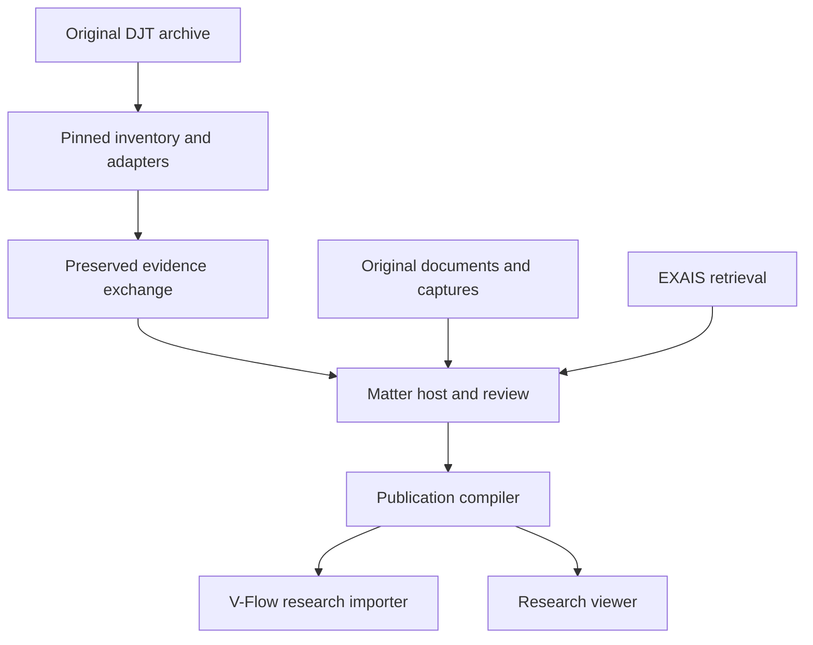

# Architecture and evidence contract

## 1. Authority and data flow

The original archive is retained. A pinned Git snapshot records exactly what was
available to the compiler. Typed adapters produce an immutable **exchange
snapshot**, not a second mutable claims database. A future host imports eligible
observations and scoped claims into Matter through its real services. EXAIS
retrieves candidate source material over its existing HTTP boundary. A publication
compiler binds selected claims to source versions, exact excerpts, material
limitations, correction history, and authenticated editorial decisions.

In this milestone A→B→C and C→review scenes are executable. The optional Matter
bridge validates real observation inputs; it does not run D as a hosted service.
The diagram's publication and downstream integrations are target responsibilities,
not a claim of completed end-to-end film rendering.

| Owner | Responsibility | Current boundary |
| --- | --- | --- |
| DJT | Original archive, editorial evidence classifications, financial meaning, topic/story membership | Existing research plus new immutable exchange |
| Matter | Observation/claim storage, receipts, accepted relationships, identity decisions, correction history | Genuine observation-input adapter; hosted claim/review workflow pending |
| EXAIS | Source ingestion, ACL-controlled retrieval, passages, graph context | Inspected existing HTTP contracts; no replacement store |
| Capture adapter | Original source hash, full-page image, crop geometry and derivative provenance | Offline PDF implementation; webpage/video adapters pending |
| Story compiler | Selection, correction application, dependency pins, review/publication gates | Research-review package and fail-closed publication boundary |
| V-Flow | Authored narration, pacing, scenes, project revision history, final rendering | New research-source importer required in its own repository |

## 2. Immutable identities and versions

Identifiers use the explicit namespace `djt:<record-kind>:<sha256>`. Their scoped
inputs include the exact source path, record kind, and unique original identifier
where one exists. Pointer/row positions disambiguate records without a reliable
local ID. The same `event-074` in two annual files is two imported records; no
global key is inferred from that string. An exact name is also insufficient to
merge people, companies, or relationships.

The original path and local ID remain separately readable. A record changing
within its original scope retains a stable identity where its source key remains
unique; its payload and source hashes change. Reordering ambiguous duplicate
rows or moving a source file may change the migration key. A later reviewed
crosswalk must express continuity rather than guessing it. This is deliberate:
stable identity cannot be manufactured where the original source offers no key.

These digests have distinct meanings:

| Digest | Meaning |
| --- | --- |
| Git commit | The complete input tree/revision used by the build |
| `origin.sha256` | SHA-256 of the exact original source file bytes |
| `origin.raw_sha256` | SHA-256 of the exact row/token/section bytes where that byte locator is available |
| `payload_sha256` | Hash of this project's deterministic decoded-payload encoding |
| `source_version.content_sha256` | Recorded acquired document hash; verification/availability are separate fields |
| `build_fingerprint` | Deterministic compiled output fingerprint |

The project's sorted UTF-8 JSON encoding is versioned and tested for repeatability.
It is not labeled RFC 8785 canonical JSON and is not substituted for Matter's
domain-specific canonical digest scheme. Original numeric tokens remain in the
source archive. Financial exchange values are strings so a consumer cannot round
a large number or silently convert a range to a single amount.

## 3. Record dictionary

The authoritative executable transport contract is
[`evidence-package.schema.json`](../djt_evidence/schemas/evidence-package.schema.json).
The story-selection contract is
[`story-manifest.schema.json`](../djt_evidence/schemas/story-manifest.schema.json).
Both use [JSON Schema Draft 2020-12](https://json-schema.org/draft/2020-12).

| Collection | What it preserves | What it does not establish |
| --- | --- | --- |
| `raw_records` | Original parsed payload, file/row locator, file and payload fingerprints, import disposition | Truth of the assertion |
| `entities` | A scoped entity occurrence or existing entity-crosswalk row and identity limitation | Global identity from a matching ID or name |
| `occurrences` | Legacy event title and date/start/end strings | That the event happened or that imprecise dates became exact dates |
| `relationships` | Original relation, endpoint labels, scoped entity references when available, source pointers, limits | An accepted association or traced funds flow |
| `observations` | That a particular repository source asserts the retained text | That a linked court document was acquired or verified |
| `claims` | Exact assertion, raw status, source references, qualifications, topic and financial/correction links | Editorial approval or historical authentication |
| `sources` | Source identity, inventory text, URL/locator and source-family note | Independence merely because URLs or IDs differ |
| `source_versions` | Distinct acquisition-linked version declarations with recorded hashes | Possession of matching bytes |
| `acquisitions` | Every recorded attempt/status, timestamp, hash/size, dependency/review limitations | Completion of an underlying company file or corpus search |
| `excerpts` | Exact text, UTF-8 text hash, explicit position unit, prefix/suffix and source version | That text supports a particular inference without review |
| `evidence_links` | Cites, supports, qualifies, or contradicts relations with exact targets | Independent corroboration or automatic approval |
| `financials` | Exact amount/currency/measure as recorded, separate roles and exclusions | A payment, receipt, bank balance, or aggregate merely because it has an amount |
| `corrections` | Controlling original sidecar, target links, superseding display meaning and restrictions | Silent deletion of the earlier assertion |
| `captures` | Capture state and source-bound derivative manifest references | New factual authority created by an image |
| `reviews` | Digest-bound editorial declarations for a host to authenticate | Authority from a self-entered reviewer name |
| `coverage` | One entry per input file, disposition and imported-record counts | That every file has received substantive review |

An import can be complete as a raw-preservation operation and still be unreviewed
as evidence. Source-family IDs remain unresolved until reviewed. Acquisition
attempts sharing a hash remain separately observable events; matching bytes do
not make two sources independent.

## 4. Migration policy and exact preservation

The inventory reads Git objects, not mutable working-tree files. Every tracked
entry is classified, including build mirrors, archived versions and delivery
artifacts. Matching file hashes form duplicate groups but no original file is
deleted. The top-level source JSON schema and network relationships file fail
JSON parsing; their original bytes and parse errors are retained, not repaired by
guessing.

The importer handles annual entity dictionaries as well as arrays. It preserves
events, entities, relationships, transactions, intelligence activity, source
citations, and remaining envelope metadata. It imports the heterogeneous chapter
columns through explicit mappings and leaves the complete original row available.
Malformed CSV rows retain their header and every cell with a quarantine
disposition. The compiler cannot treat a quarantined row as an accepted claim.

Validation reconciles the proposed exchange against a deterministic replay from
the pinned source tree. Recomputing a payload hash or lowering a coverage count
cannot hide a deleted or changed source assertion. New retained evidence and
editorial declarations pass separate declared extension checks.

## 5. Financial semantics

Every imported financial observation starts excluded from totals and disabled
for cash-flow animation. This avoids reinterpreting purchase price, programme
ceiling, shareholding, instrument holding, debt forgiveness, guarantee fee due,
assignment, prospective financing, and reported cash as the same measure.

Existing `include_in_totals` and financial-ledger floor flags remain in the raw
payload. They are not copied into a new approved total. This preserves both the
old methodology and the stronger boundary required before a downstream renderer
animates a payment. An aggregation extension will require an explicit measure,
currency, payer/agent/benefited obligor/ultimate payee roles, economic-event overlap
group, inclusion decision and source-bound reviewed amount. It is a later ticket.

The RF-014 and two legacy Toronto exclusions remain controlling. The $850m
upstream price, $105.825m court-described payment, $15m withdrawn/unconfirmed
contribution, $100m unsupported legacy amount, CAD obligations, and RUB holdings
are never normalized into one additive number by this importer.

## 6. Evidence selection and publication

The review compiler only selects claim IDs present in the exchange. It emits
the original assertion, controlling display wording where applicable, all
qualifications, supporting pointers, financial restrictions, and publication
blockers. A review scene is visibly a research-review object, not a statement that
the claim has passed historical or editorial review.

Publication needs exact supporting excerpts, the matching retained source bytes,
all material supporting/qualifying/contradicting links, and an editorial decision
bound to the current dependency digest. An in-package review is a declaration:
the embedding host must authenticate the exact review before passing its digest
as trusted input. The CLI does not supply a self-approval switch. A newer review,
changed context, correction, or source version invalidates the earlier dependency
decision. The previous output remains immutable for provenance.

The first text excerpt verifier supports exact UTF-8 source positions and
prefix/suffix context. PDF capture is independently implemented, but PDF-to-text
excerpt derivation and capture-to-publication binding are not yet admitted.
`capture_policy=required` therefore blocks publication in this milestone.
Optional missing images produce a citation-card fallback without erasing a claim.

The position and quote-context design follows the useful separation of body,
target and selectors in the [W3C Web Annotation model](https://www.w3.org/TR/annotation-model/).
This custom JSON exchange is not advertised as a fully conformant JSON-LD Web
Annotation serialization. Source, transformation and derivative separation also
follows [W3C PROV concepts](https://www.w3.org/TR/prov-overview/); it is not a
claim that storing a provenance record authenticates the record's contents.

## 7. Incremental operation and external work

A build names its source commit and compiler version. Rebuilds from the same
commit are deterministic. A newer source commit creates a new immutable package.
Context dependencies are conservative: a chapter context-file change can require
review of that chapter's selected claims, even if a smaller semantic subset might
eventually be proven unaffected. An unlinked new piece of counterevidence cannot
be discovered by a digest algorithm alone; topic/claim associations still need
research review.

PR #29 was separately inspected as draft, unmerged work. Its observed head during
this audit was `0c6f2187d177382bc1a5c310c1702a6818129ebd`. This milestone's reports
pin accepted main `d5f1b11a0500d5d577f4553d7e6d13a0aa69e494` and do not merge or
silently promote that draft. After its review/merge, re-run the same inventory and
adapters at the resulting main commit; new CSV rows are discoverable without
altering historical input packages.
